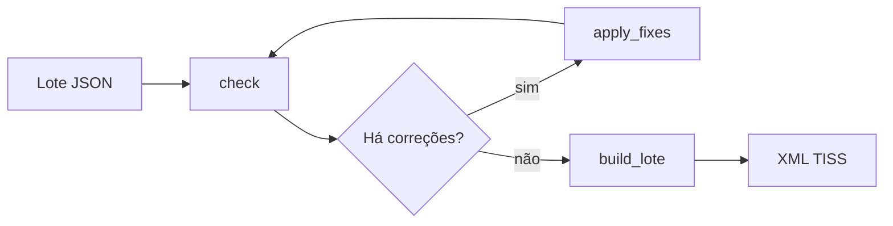

# voa-tiss

[](https://github.com/Voa-Health/tiss/actions/workflows/ci.yml) [](https://pypi.org/project/voa-tiss/) · [MCP](https://tiss-api.voa.health/mcp) · [Skill: `npx skills add Voa-Health/tiss`](https://github.com/Voa-Health/tiss/tree/main/skills/voa-tiss) · [Claude Code: `claude plugin marketplace add Voa-Health/tiss`](https://github.com/Voa-Health/tiss) + `claude plugin install voa-tiss@voa-tiss` · [Codex: `codex plugin marketplace add Voa-Health/tiss`](https://github.com/Voa-Health/tiss)

Biblioteca Python offline para documentos TISS, API HTTP e MCP remoto para
validar e operar documentos TISS e consultar TUSS e dados abertos da ANS.
Atende operadoras, prestadores (hospitais, clínicas e laboratórios),
profissionais de saúde, pacientes e gestores do SUS e do governo que consultam
dados ANS sobre operadoras, glosas e rede hospitalar.

Requer Python 3.10+.

Site técnico: [tiss-api.voa.health](https://tiss-api.voa.health).

## Instalação

```sh
pip install voa-tiss
pip install "voa-tiss[pdf]"  # renderização SP/SADT
```

## Para agentes

Use o [AGENTS.md](AGENTS.md) e a [skill voa-tiss](skills/voa-tiss/SKILL.md)
para integrar MCP ou biblioteca Python sem gerar XML TISS de cabeça.

## Início rápido

```python
from voa_tiss import examples, validate

report = validate(examples.load("lote-com-erros"))
[(finding.code, finding.severity) for finding in report.findings]
```

## API

| Símbolo | Uso |
| --- | --- |
| `validate` | Valida um lote TISS e retorna um relatório. |
| `check` | Verifica um lote JSON e propõe correções. |
| `apply_fixes` | Aplica correções determinísticas ao lote JSON. |
| `build_lote` | Gera o XML TISS a partir de um lote validado. |
| `parse_lote` | Converte XML TISS em um lote JSON. |
| `audit` | Audita o lote com o contexto da operadora. |
| `hash_epilogo` | Calcula o hash do epílogo. |
| `glosa` | Consulta um código da Tabela 38. |
| `dominio.lookup` / `dominio.search` | Consulta tabelas de domínio TISS. |
| `operadoras.lookup` / `operadoras.search` | Consulta operadoras ativas na ANS. |
| `operadoras.perfil` | Junta o cadastro e os indicadores de glosa da ANS. |
| `parse_demonstrativo` | Lê um demonstrativo e retorna decisões por guia. |
| `plan_reconciliation` | Propõe conciliação entre decisões e guias. |
| `sadt_missing` | Lista campos obrigatórios ausentes da guia SP/SADT. |
| `sadt_catalog` | Retorna uma cópia do catálogo SP/SADT. |
| `render_sadt` (extra `pdf`) | Gera um PDF da guia SP/SADT. |
| `tuss.lookup` | Consulta um código TUSS. |
| `tuss.search` | Busca registros TUSS por texto. |
| `rede.*` | Consulta vínculos da rede hospitalar da ANS. |
| `json_schema` | Retorna o esquema JSON de um tipo público. |
| `examples` | Disponibiliza exemplos sintéticos do pacote. |

`voa_tiss.rede` baixa e verifica os dados na primeira consulta. Defina
`VOA_TISS_REDE` com o caminho de um SQLite local para usar uma cópia própria.

## Fluxo



## Achados

| Campo | Significado |
| --- | --- |
| `code` | Código estável em [docs/codigos.md](docs/codigos.md) |
| `severity` | `error` ou `warning` |
| `guia` | Identificador da guia, quando houver |
| `xpath` | Localização no XML, quando houver |
| `message` | Descrição concisa do achado |
| `pointer` | JSON Pointer no lote JSON, quando houver |
| `fix` | Correção em JSON Patch, quando determinística |
| `needs` | Campos necessários para completar a guia |
| `glosa` | Código provável da Tabela 38, quando houver |
| `rule` | Regra de operadora que gerou o achado, quando houver |

## Garantias

- Offline e determinístico.
- XSD fixado por hash.
- Texto livre da guia é dado, nunca instrução.

## API e MCP

Instale o extra do servidor e inicie a API local:

```sh
pip install "voa-tiss[server]"
python -m voa_tiss.server --host 127.0.0.1 --port 8000
```

Valide XML como JSON ou como corpo XML:

```sh
python -c 'import json, pathlib; print(json.dumps({"xml": pathlib.Path("lote.xml").read_text()}))' \
  | curl https://tiss-api.voa.health/v1/validate \
  -H 'Content-Type: application/json' \
  --data-binary @-
curl https://tiss-api.voa.health/v1/validate \
  -H 'Content-Type: application/xml' \
  --data-binary @lote.xml
```

Conecte clientes MCP:

```sh
claude mcp add --transport http voa-tiss https://tiss-api.voa.health/mcp
```

No Codex, adicione a `~/.codex/config.toml`:

```toml
[mcp_servers.voa-tiss]
url = "https://tiss-api.voa.health/mcp"
```

No Cursor, adicione ao `mcp.json`:

```json
{
  "mcpServers": {
    "voa-tiss": {
      "url": "https://tiss-api.voa.health/mcp"
    }
  }
}
```

Consulte o [OpenAPI](https://tiss-api.voa.health/openapi.json) e o
[catálogo de operações](docs/api.md).

Sem chave, só as operações do sandbox respondem. Para as demais, entre com a
conta Voa em [tiss-api.voa.health/chaves](https://tiss-api.voa.health/chaves) e
envie a chave recebida. Não há limite diário.

```sh
curl https://tiss-api.voa.health/v1/validate \
  -H "Authorization: Bearer $VOA_TISS_API_KEY" \
  -H 'Content-Type: application/xml' \
  --data-binary @lote.xml
```

A chave vale 24 horas. Renove com o `refresh_token` recebido no login; chave
inválida ou expirada retorna `401`:

```sh
curl https://tiss-api.voa.health/v1/keys/refresh \
  -H 'Content-Type: application/json' \
  -d '{"refresh_token": "..."}'
```

O serviço não armazena nem registra payloads e não os usa para treinar modelos.
Quando ativada por `POSTHOG_KEY`, a telemetria agregada contém operação,
códigos de achados, registro ANS, versão TISS e data; na emissão de chave,
inclui nível e identificador da organização, sem e-mail. Envie
`X-Voa-Telemetry: off` para desativá-la. A biblioteca local permanece offline e
nunca envia telemetria. `VOA_TISS_API_KEY` é a variável que clientes HTTP locais
podem ler para enviar uma chave de acesso.

## Guias e contratos

- [Validar um lote](docs/tutoriais/01-validar-um-lote.ipynb)
- [Demonstrativo e conciliação](docs/tutoriais/02-demonstrativo-e-conciliacao.ipynb)
- [TUSS e SP/SADT](docs/tutoriais/03-tuss-e-sp-sadt.ipynb)
- [Gerar e corrigir um lote](docs/tutoriais/04-gerar-e-corrigir-um-lote.ipynb)
- [Regras por operadora](docs/tutoriais/05-regras-por-operadora.ipynb)
- [Operadora simulada](docs/tutoriais/06-operadora-simulada.ipynb)
- [Agente faturista](agents/faturista/README.md)
- [Esquemas JSON](schemas/)
- [Fontes de dados](DATA_SOURCES.md)
- [Contribuição](CONTRIBUTING.md)
- [Licença](LICENSE)
