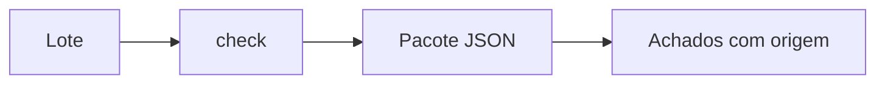

# Regras por operadora

Pacotes JSON usam o contrato de [`rules.schema.json`](https://github.com/Voa-Health/tiss/blob/main/schemas/rules.schema.json).
Cada regra declara a origem, a severidade, o caminho e uma primitiva segura.
O caractere `*` percorre itens de listas. Padrões usam `re.fullmatch` e têm
limite de 200 caracteres.

Primitivas: `obrigatorio`, `padrao`, `valores`, `max_itens` e
`combinacao_proibida`. Pacotes não executam código Python.

Regras oficiais exigem mantenedor do tipo `operadora` e fonte publicada.
Pacotes de exemplo devem usar dados sintéticos.

## Publicação pela operadora

Salve um pacote válido em `src/voa_tiss/rules/NNNNNN.json`, com o registro ANS de seis dígitos
no nome, fonte e data em cada regra e `mantenedor` com `tipo: operadora` e `registro_ans`.
Envie a contribuição pelo GitHub; as verificações automáticas validam o pacote. Após
aprovação por responsável com e-mail no domínio cadastrado da operadora na ANS, as regras
recebem o selo Oficial.
Novas regras e ajustes são enviados pelo GitHub.
