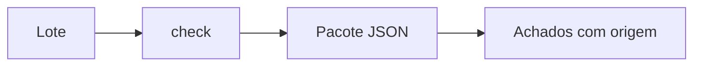

# Regras por operadora

Pacotes JSON usam o contrato de [`schemas/rules.schema.json`](../schemas/rules.schema.json).
Cada regra declara a origem, a severidade, o caminho e uma primitiva segura.
O caractere `*` percorre itens de listas. Padrões usam `re.fullmatch` e têm
limite de 200 caracteres.

Primitivas: `obrigatorio`, `padrao`, `valores`, `max_itens` e
`combinacao_proibida`. Pacotes não executam código Python.

Regras oficiais exigem mantenedor do tipo `operadora` e fonte publicada.
Pacotes de exemplo devem usar dados sintéticos.
